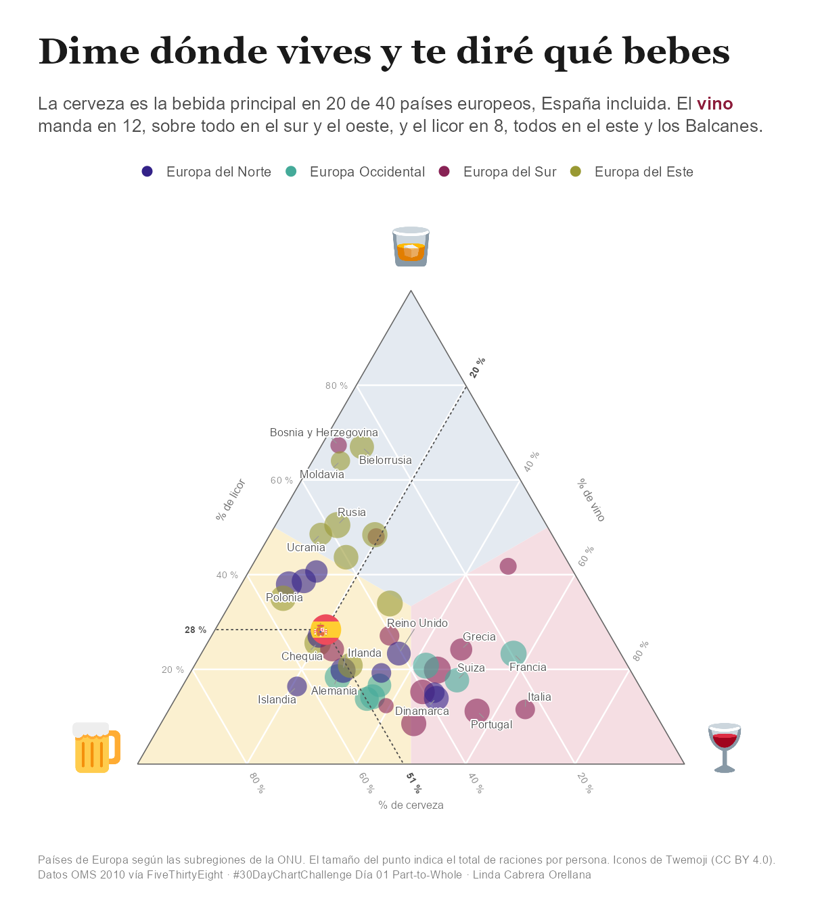

# Día 01 · Part-to-Whole

 

## Pregunta 
Cómo reparten los países europeos su consumo de alcohol entre cerveza, licor y vino, y qué bebida gana en cada zona de Europa.

## Gráfico
Diagrama ternario. Muestra un total repartido en tres partes para muchos casos a la vez. Cada país es un punto dentro de un triángulo, como si fueran 40 gráficos de tarta en uno solo. Los puntos se colorean según la subregión de Europa y el fondo del triángulo se tiñe según la bebida que gana en cada zona.

## Datos
Raciones por persona de cerveza, licor y vino en 2010. Organización Mundial de la Salud, Global Information System on Alcohol and Health, publicado por [FiveThirtyEight](https://github.com/fivethirtyeight/data/tree/master/alcohol-consumption) y también disponible en el paquete `fivethirtyeight` como `drinks`. Las subregiones se asignan con la clasificación de la ONU mediante el paquete `countrycode`.

## Limitaciones
Los datos son de 2010 y existen datos más recientes de la OMS, con el reparto por tipo de bebida hasta 2019 y en litros de alcohol puro. Los porcentajes se calculan sobre raciones, no sobre litros de alcohol puro. El gráfico solo incluye Europa, y quedan fuera Mónaco y San Marino porque su consumo registrado es cero y no se pueden situar en el triángulo. Los países que beben muy poco pueden aparecer en una esquina aunque su consumo sea mínimo, por eso el tamaño del punto indica el total de raciones.

## Lo que aprendí

- Antes de elegir la historia hay que explorar los datos, porque un dataset puede parecer bueno y tener problemas serios.
- En un diagrama ternario cada bebida se lee en un lado distinto, y teñir las zonas según qué parte gana hace que se entienda sin explicaciones.
- Menos puntos y bien elegidos cuentan mejor la historia que todos los países a la vez.
- Las paletas cualitativas de CARTO reservan el último color para un gris de otros, así que hay que pedir un color más de los que se necesitan.
- Con R 4.2 conviene instalar paquetes con type = "binary" para evitar compilar.
- La ventana de gráficos de RStudio puede dibujar mal los textos de ggtext si no encuentra la fuente. Con el backend AGG se ve igual que el PNG final.
- Los iconos con licencia abierta, como Twemoji, necesitan atribución en la nota del gráfico.

## Difusión
Pendiente.
