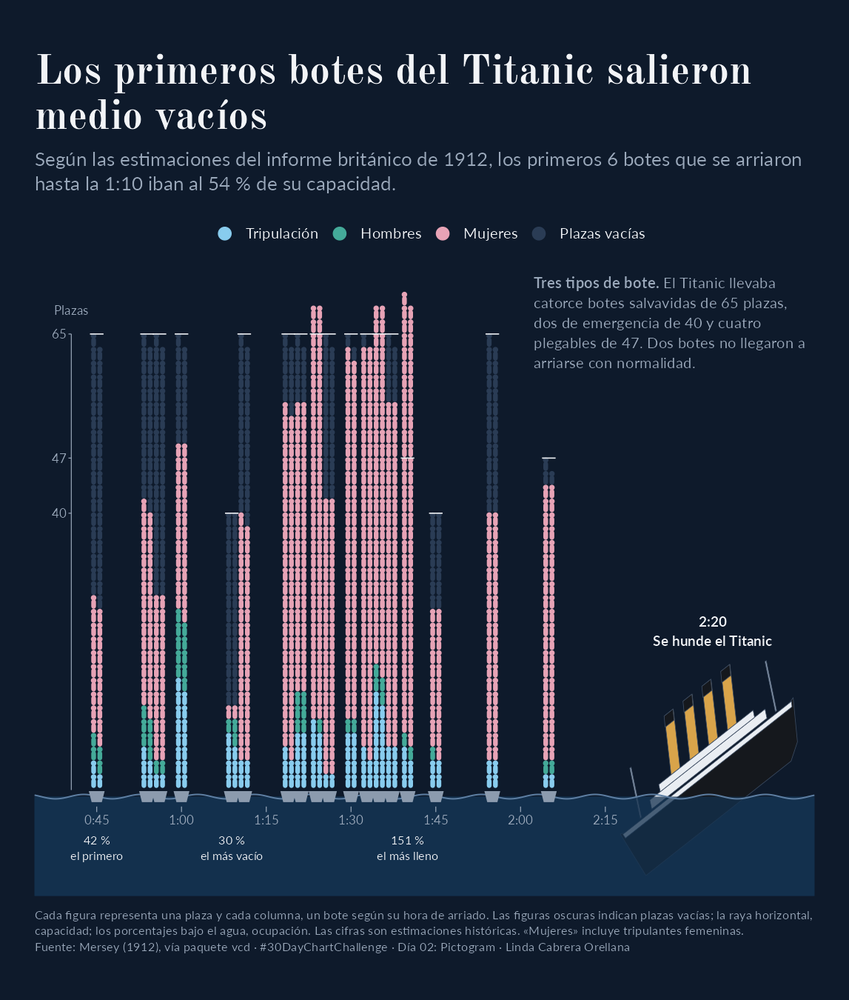

# Día 02 · Pictogram

 

## Pregunta
Cómo de llenos salieron los botes salvavidas del Titanic a medida que avanzaba la noche del hundimiento.

## Gráfico
Pictograma en forma de escena. El eje horizontal es la hora real en que se arrió cada bote, entre las 0:45 y las 2:20, y su línea es la superficie del mar. Cada bote es una columna que flota en su hora, con una figura por plaza apilada en filas de dos, coloreada según quién la ocupaba (tripulación, hombres o mujeres), y las plazas vacías en un azul oscuro que casi se funde con la noche. Una rayita marca la capacidad de cada bote, y el eje de la izquierda muestra los tres tamaños de bote que llevaba el Titanic. Bajo el agua aparece la ocupación de tres botes destacados, el primero en salir, el más vacío y el más lleno. El barco hundiéndose está dibujado con polígonos.

## Datos
Ocupantes y capacidad de los 18 botes que se arriaron, con su hora de salida, según el informe británico sobre el hundimiento (Mersey, 1912). Los recoge Michael Friendly en el paquete `vcd` como `Lifeboats`. Los tipos de bote (catorce de 65 plazas, dos de emergencia de 40 y cuatro plegables de 47) están documentados en fuentes como [Encyclopedia Titanica](https://www.encyclopedia-titanica.org/titanic-lifeboat-occupancy-totals.html).

## Limitaciones
Las cifras del informe suman 854 ocupantes, más que los cerca de 710 supervivientes, así que sobreestiman la ocupación y en realidad hubo más plazas vacías. Por eso tres botes, el 11, el 15 y el C, aparecen por encima de su capacidad. Las mujeres incluyen a las tripulantes. Los botes que salieron a la misma hora se separan uno o dos minutos para que no se monten. Faltan los plegables A y B, que no llegaron a arriarse con normalidad.

## Lo que aprendí

- La metáfora visual también comunica, el mar, los botes y el Titanic permiten construir una escena reconocible sin abandonar la representación cuantitativa.
- La oscuridad refuerza el contexto nocturno y hace que las plazas vacías se integren visualmente en la escena.
- R permite construir composiciones editoriales completas. La combinación de pictogramas, polígonos, anotaciones y tipografía personalizada permite ir más allá de los gráficos convencionales.
- La gestión de tipografías mejora la reproducibilidad. Guardar las fuentes en el proyecto y registrarlas con systemfonts favorece resultados consistentes entre equipos. Las fuentes con licencia OFL pueden distribuirse respetando las condiciones de su licencia.

## Difusión

Pendiente.
