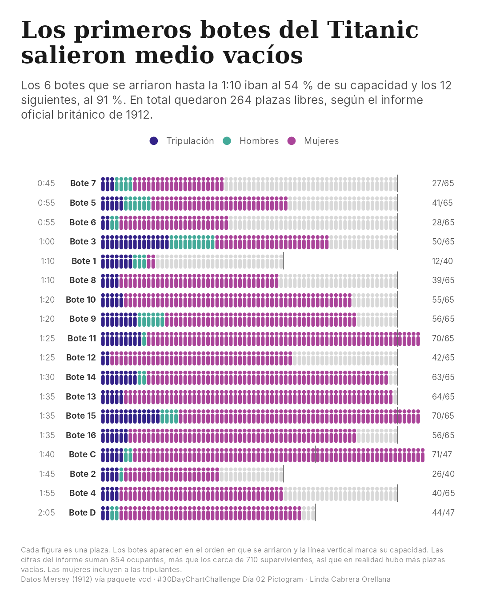
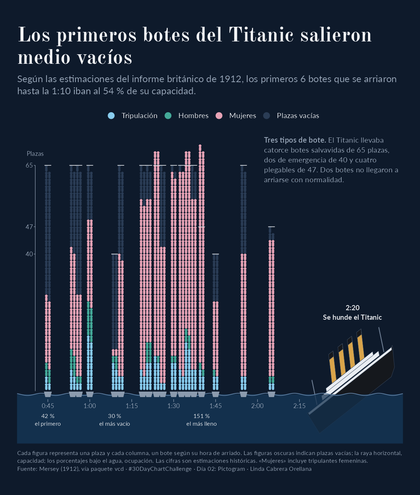

# Proceso de diseño · Día 02 · Pictogram

## 1. Concepto y planificación

Partí de la hipótesis que los primeros botes del Titanic salieron con muchas plazas vacías, con base al EDA.

Antes de diseñar, revisé visualizaciones existentes de estos datos, incluyendo las de `vcd` y *National Post*. Buscaba una representación diferente basado en un pictograma plaza a plaza que combinara información cuantitativa y narrativa visual.

## 2. Prototipo inicial

A partir de la planificación, indiqué a Claude el contexto, la fuente de datos y el objetivo de la visualización que era representar mediante pictogramas la ocupación de los botes salvavidas del Titanic durante el hundimiento. Claude generó una primera propuesta en R, que utilicé como punto de partida para el proceso de revisión y rediseño editorial.

El resultado facilitaba la comparación entre botes, pero no transmitía el contexto del hundimiento. También detecté una afirmación en el subtítulo que no estaba respaldada por los datos.

## 3. Decisiones editoriales e iteraciones con IA

A partir del prototipo, dirigí tres cambios principales con Claude:

- **Composición:** transformar las filas horizontales en columnas sobre el mar, utilizando la superficie como eje temporal.
- **Ambientación:** explorar diferentes fondos y elegir una escena nocturna coherente con el acontecimiento.
- **Narrativa:** incorporar el Titanic hundiéndose como cierre visual de la cronología.

Después ajusté directamente el código R: espaciado, etiquetas, anotaciones, leyenda y tipografías.

La IA facilitó el prototipado y la implementación técnica. La conceptualización, evaluación de alternativas y dirección editorial fueron propias.

## 4. Aprendizajes

La transformación implicó una decisión consciente: **priorizar la narrativa temporal frente a la comparación detallada entre botes**.

El aprendizaje principal fue comprobar que la IA permite explorar soluciones visuales complejas con mayor agilidad, pero sus propuestas requieren validación estadística y criterio editorial.
