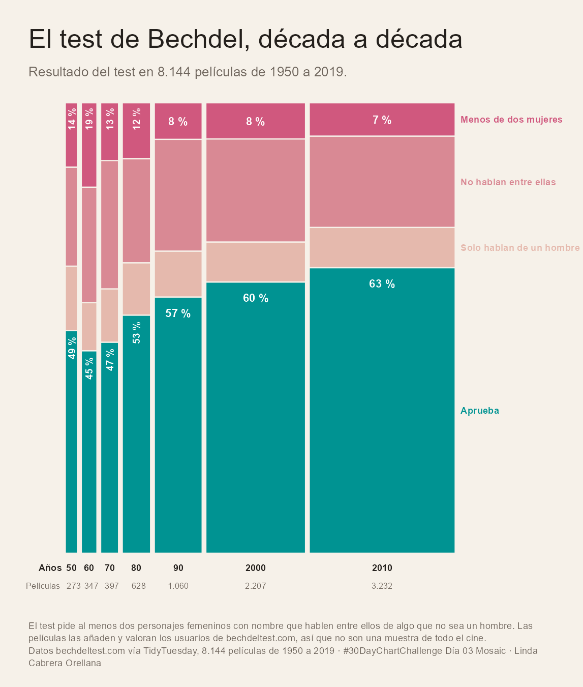

# Día 03 - Mosaic

 

## Pregunta

Cómo se reparten las películas de cada década según el resultado del test de Bechdel.

## Gráfico

Mosaico o Marimekko. Cada columna es una década, de los años 50 a la de 2010, y su ancho indica cuántas películas tiene, desde 273 en los 50 hasta 3.232 en la década de 2010. Dentro de cada columna, los segmentos muestran la proporción de películas que aprueban el test, abajo, y las que suspenden en cada uno de sus tres pasos, de menos a más grave hacia arriba.

El mosaico se construye con `geom_rect()`, calculando los rectángulos a mano, en lugar de usar `ggmosaic`.

## Datos

Resultado del test de Bechdel de 8.144 películas estrenadas entre 1950 y 2019, de [bechdeltest.com](https://bechdeltest.com), publicados por TidyTuesday en la semana del [9 de marzo de 2021](https://github.com/rfordatascience/tidytuesday/tree/main/data/2021/2021-03-09). Se cargan con `tidytuesdayR::tt_load("2021-03-09")`. La puntuación va de 0 a 3:

- 0: significa que no hay al menos dos personajes femeninos con nombre,

- 1: que no hablan entre ellos,

- 2: que solo hablan de un hombre y

- 3: que la película aprueba.

## Limitaciones

Las películas las añaden y valoran los usuarios de bechdeltest.com, así que no son una muestra representativa de todo el cine y la valoración puede variar de una persona a otra. Se excluyen las películas anteriores a 1950, porque cada década tiene pocas, y las de 2020 y 2021, que solo suman 104.

## Lo que aprendí

- Un mosaico necesita segmentos que se vean.
- Para una categoría buena y varias malas ordenadas, lo que encaja es una paleta divergente, con un color para aprobar y un degradado para los pasos del suspenso.
- Es mejor tomar los colores de una paleta publicada y apta para daltonismo, como BrBG de RColorBrewer o sunset de khroma, que elegirlos a mano.
- En las columnas estrechas las etiquetas se montan. Girarlas en vertical solo donde hace falta, y sacar los nombres de los ejes a la izquierda, resuelve el problema.
- Un titular descriptivo deja que el lector saque sus conclusiones, mientras que el mismo gráfico con un titular que afirma algo se convierte en una pieza editorial. Las dos opciones son válidas, pero hay que elegir una.

## Difusión

Pendiente.
