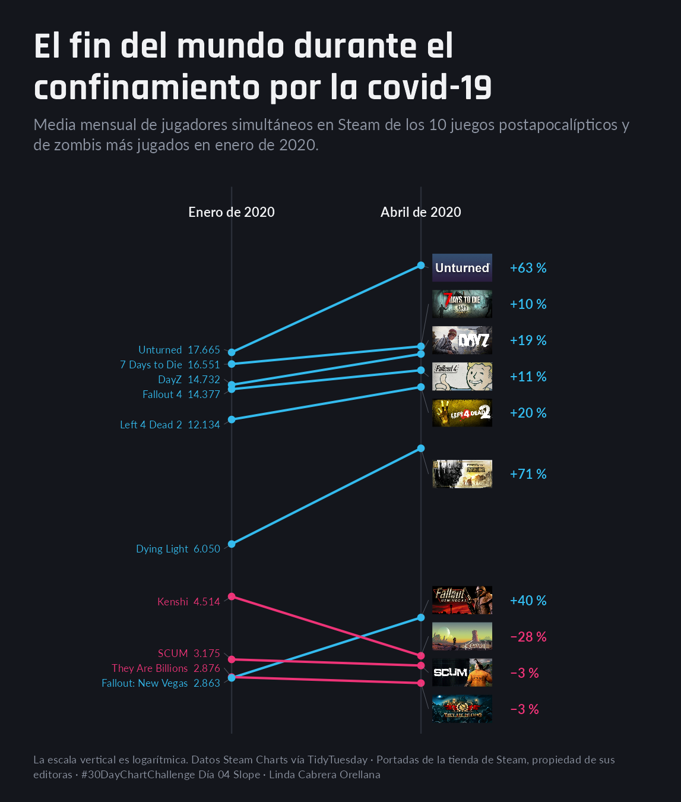

# Día 04 · Slope

 

## Pregunta

Quería saber si jugamos más al fin del mundo cuando el mundo real se paró, así que comparé cuántas personas jugaban en Steam a los juegos postapocalípticos y de zombis más populares justo antes de la pandemia y en el primer mes completo de confinamiento.

Además, es uno de mis géneros favoritos ❤️🧟, y Fallout es mi saga preferida.

## Gráfico

Un gráfico de pendiente une para cada juego su media de jugadores simultáneos en enero de 2020 con la de abril de 2020. La línea azul indica que el juego sube y la rosa que baja, y a la derecha aparece la portada del juego en la tienda de Steam junto al porcentaje de cambio.

El eje vertical está en escala logarítmica porque los juegos van de menos de 3.000 a casi 29.000 jugadores. Así la inclinación de cada línea muestra el cambio relativo y un juego pequeño que crece un 40 % se ve igual de empinado que uno grande que crece lo mismo.

## Datos

Los datos vienen de [Steam Charts](https://steamcharts.com/) a través de [TidyTuesday](https://github.com/rfordatascience/tidytuesday/tree/master/data/2021/2021-03-16) (semana del 16 de marzo de 2021) y se cargan con `tidytuesdayR::tt_load("2021-03-16")`. Cada fila es la media mensual de jugadores simultáneos de un juego en Steam.

Seleccioné juegos postapocalípticos, de zombis y de supervivencia en un mundo arrasado con datos en enero y abril de 2020, y me quedé con los diez que tenían más jugadores en enero.

## Limitaciones

Ningún mes es un punto de partida limpio. Febrero ya refleja la cuarentena en China, que empezó el 23 de enero, y diciembre está inflado por las vacaciones y las rebajas de invierno de Steam. Enero es el mejor compromiso, aunque también tiene sus estrenos.

Steam cuenta a todos los jugadores que usan su cliente, estén donde estén, pero no dice de qué país son. Por eso no se puede separar el efecto del confinamiento chino del europeo o del americano. Tampoco cuenta a quien juega en consola o en otras tiendas.

## Lo que aprendí

Elegir el periodo de comparación cambia la historia. Probé febrero, enero y diciembre como punto de partida y cada uno daba resultados distintos por estrenos, rebajas o noticias, así que revisar el calendario de cada juego fue tan importante como el gráfico.

Al principio usé los 15 juegos más jugados de Steam y el centro del gráfico era un nudo de líneas imposible de leer. Con diez juegos y una temática concreta el gráfico se entiende de un vistazo.

También aprendí a colocar las etiquetas a mano repartiéndolas en escala logarítmica, porque ggrepel no permite poner imágenes en las posiciones que calcula, y a incluir imágenes en un gráfico de ggplot2 con `geom_richtext()` de ggtext.

## Difusión

Pendiente.
