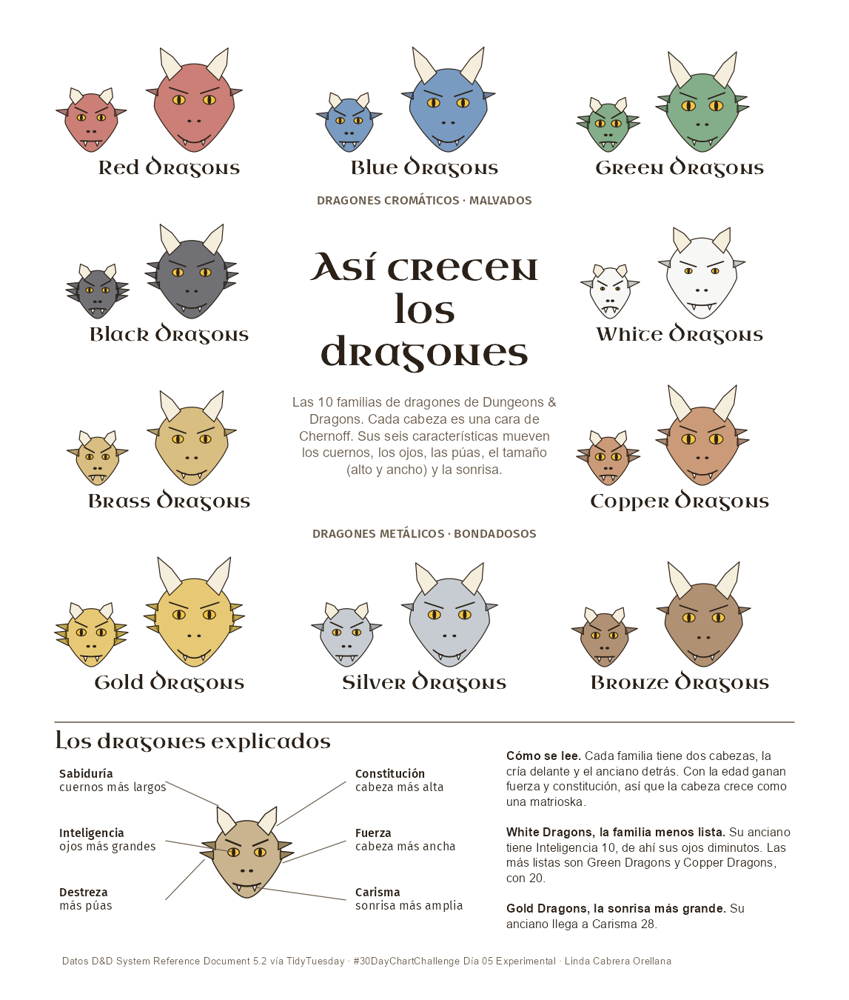

# Día 05 - Experimental

 

## Pregunta

¿Cómo cambian Los dragones de Dungeons & Dragons al crecer y qué distingue a cada familia?

Quería probar un gráfico poco habitual, y he descubierto las caras de Chernoff, además de datos que de verdad se presten a ello. Los dragones de Dungeons & Dragons eran perfectos para este tipo de gráfico.

## Gráfico

Las caras de Chernoff las propuso el estadístico Herman Chernoff en 1973. Convierten cada variable en un rasgo del rostro, porque reconocemos caras y sus diferencias casi sin esfuerzo. Aquí la cara es una cabeza de dragón dibujada a mano en ggplot2, y cada una de sus seis características mueve un rasgo.

| Característica | Rasgo                |
|----------------|----------------------|
| Fuerza         | ancho de la cabeza   |
| Constitución   | alto de la cabeza    |
| Inteligencia   | tamaño de los ojos   |
| Sabiduría      | largo de los cuernos |
| Carisma        | sonrisa              |
| Destreza       | número de púas       |

Cada familia tiene dos cabezas, la cría delante y el anciano detrás. Como la fuerza y la constitución crecen con la edad, la cabeza crece sola dentro de cada familia, igual que unas matrioskas.

Al comparar familias aparecen las diferencias. El dragón blanco es el menos listo y su anciano solo llega a Inteligencia 10, por eso tiene los ojos diminutos. Los más listos son el verde y el cobre, que alcanzan 20. El dragón de oro anciano es el más carismático, con 28, y tiene la sonrisa más amplia.

## Datos

Los datos son los monstruos del System Reference Document 5.2 de D&D, el reglamento abierto de la edición de 2024, publicados en [TidyTuesday](https://github.com/rfordatascience/tidytuesday/tree/main/data/2025/2025-05-27) (semana del 27 de mayo de 2025). Se cargan con `tidytuesdayR::tt_load("2025-05-27")` e incluyen 330 monstruos con sus seis características.

La columna `category` es la entrada del manual en la que aparece cada monstruo. Diez de esas entradas son las familias de dragones, cada una con cuatro edades, cría, joven, adulto y anciano. Me quedé con la cría y el anciano de cada familia, 20 dragones, para que las cabezas fueran más grandes. Cada característica se escala entre el mínimo y el máximo de esos 20 dragones.

La división entre dragones cromáticos y metálicos no corresponden a una columna, pero coincide con el alineamiento del juego, ya que los cinco cromáticos son malvados y los cinco metálicos son bondadosos.

## Limitaciones

Las caras de Chernoff sirven para ver patrones, no para leer valores exactos. No percibimos todos los rasgos por igual, el tamaño de la cabeza llama más la atención que la longitud de los cuernos, así que la elección de qué variable va a cada rasgo cambia lo que se ve primero.

La destreza solo toma tres valores entre estos dragones, 10, 12 y 14, por eso se representa con una, dos o tres púas en lugar de un rasgo continuo.

## Lo que aprendí

- El dataset decide si unas caras de Chernoff funcionan. Los dragones tienen diferencias mucho mayores entre familias y entre edades.

- Para este día también probé un mapa de color en espacio HSL con la encuesta de colores de xkcd y lo descarté, porque no me gustó ni conseguía expresar un mensaje.

- En R hay varios paquetes para caras de Chernoff, como `aplpack`, `TeachingDemos` y `DescTools` con gráficos base, o `ggChernoff`, que las convierte en una geom de ggplot2. Todos dibujan caras humanas, así que la cabeza de dragón la dibujé a mano. Con ello aprendí a construir un glifo propio con polígonos en ggplot2 y a componer todo el gráfico en coordenadas de píxeles, con el lienzo de 1080 por 1350 como sistema de referencia.

## Difusión

Pendiente.
