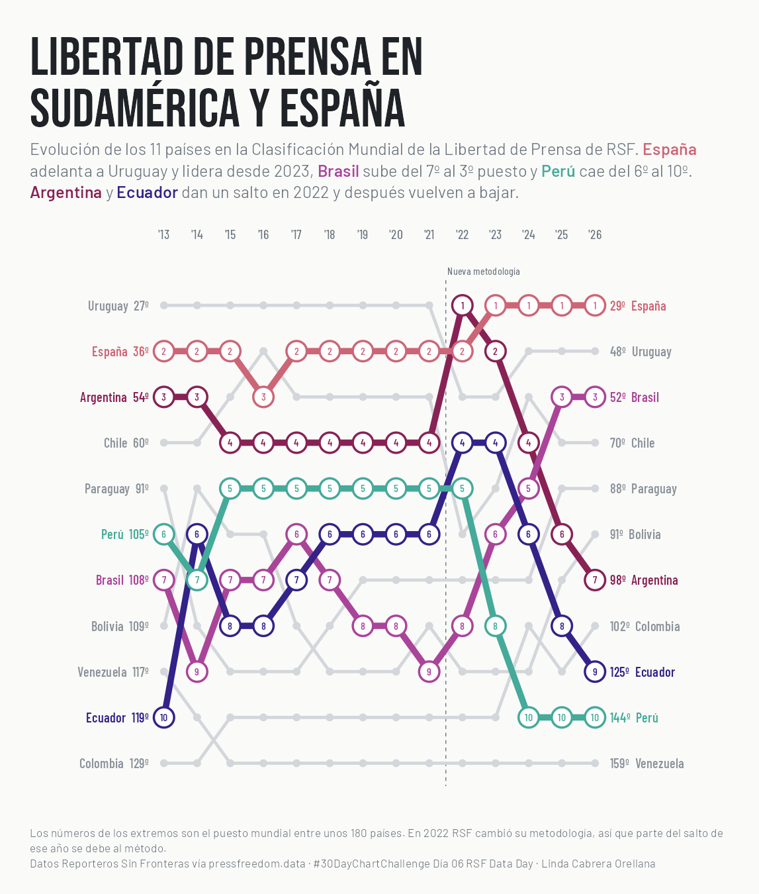

# Día 06 - RSF Data Day

 

## Pregunta

¿Cómo ha cambiado la libertad de prensa en Sudamérica y España durante la última década, qué países han ganado posiciones y cuáles las han perdido?

## Gráfico

Un bump chart sigue la posición de cada país a lo largo del tiempo, así que lo importante no es el valor sino el orden y los adelantamientos entre países. Aquí la posición vertical es el puesto de cada país entre los 11 de la comparación, calculado a partir de su puesto mundial, y los números de los extremos recuperan el puesto mundial de 2013 y de 2026 para no perder la referencia global.

Cinco países van en color y el resto en gris como contexto. España adelanta a Uruguay y lidera el grupo desde 2023, pasando del puesto 36 al 29 en el mundo, mientras Uruguay baja del 27 al 48. Brasil es el que más sube, del puesto 108 al 52, y Perú el que más cae, del 105 al 144. Argentina y Ecuador dan un gran salto en 2022, Argentina llega a liderar el grupo ese año, y después los dos vuelven a bajar hasta terminar por debajo de donde estaban.

## Datos

Los datos vienen del paquete [pressfreedom.data](https://cran.r-project.org/package=pressfreedom.data), publicado en CRAN en agosto de 2026, que trae la clasificación de RSF de 2002 a 2026 limpia y con códigos ISO. Se carga con `pressfreedom.data::rwb_standardized`, así que no hace falta descargar nada de la web de RSF.

Uso España y los 10 países hispanohablantes y lusófonos de Sudamérica, de 2013 a 2026, y los 11 tienen dato en los 14 años. Guyana y Surinam también aparecen en el índice, pero los dejé fuera para comparar países con lengua e historia compartidas con España.

## Limitaciones

- RSF cambió su metodología en 2022, con una nueva forma de puntuar basada en cinco indicadores, contexto político, económico, legal, social y seguridad.

- El puesto dentro del grupo depende de los países elegidos, si se añadieran otros cambiaría el orden. Además, un país puede subir en el grupo solo porque los demás empeoran más, y la clasificación mundial tampoco tiene siempre el mismo número de países, 179 en 2013 y 180 en 2026.

- La clasificación es una valoración de RSF elaborada con cuestionarios a especialistas y su registro de agresiones a periodistas, así que resume la situación de cada país en un número y deja fuera muchos matices.

## Lo que aprendí

- Antes de buscar en la web merece la pena buscar en CRAN, porque para un data day pensaba descargar los CSV de RSF y resultó que había un paquete reciente con todo el histórico ya limpio.

- También aprendí que en un bump chart el número de categorías decide si se lee o no. Mi primera versión tenía 21 países de Latinoamérica y era difícil seguir las líneas, con 11 países cada historia se distingue y las que van en gris dan contexto sin estorbar.

## Difusión

Pendiente.
