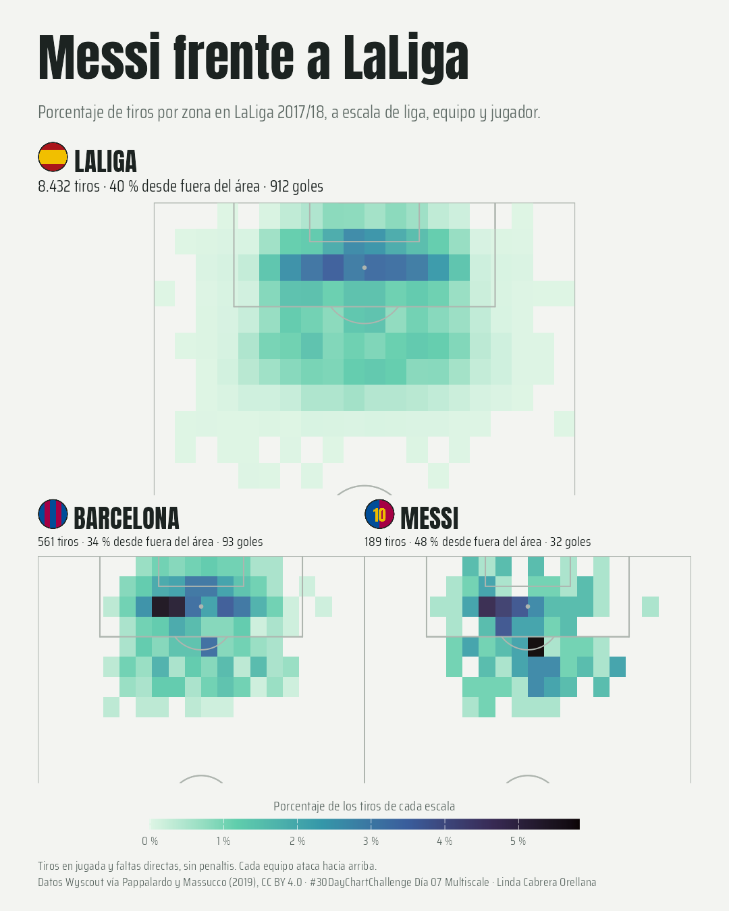

# Día 07 - Multiscale

 

## Pregunta

¿La forma de disparar de un jugador se distingue de la de su equipo y de la de toda la liga?

## Gráfico

Un mapa de calor de tiros divide el campo en celdas y colorea cada una según cuántos tiros salen de ella. El gráfico repite ese mapa a tres escalas, la liga arriba y debajo el equipo y el jugador, y en cada una la celda muestra el porcentaje de los tiros de esa escala, no el número de tiros. Así las tres comparten la misma escala de color y se pueden comparar aunque la liga tenga 8.432 tiros, el Barcelona 561 y Messi 189.

La liga dispara repartida por todo el frente del área, mientras que el Barcelona y sobre todo Messi concentran sus tiros en pocas zonas. Messi tira más de lejos, el 48 % de sus tiros llega desde fuera del área, frente al 34 % del Barcelona y el 40 % de la liga, y su zona más oscura está justo en la frontal. Además lanza 47 de las 453 faltas directas de toda la temporada, una de cada diez de LaLiga.

## Datos

Los datos son los eventos de partido de Wyscout publicados por Pappalardo y Massucco en 2019 con licencia CC BY 4.0 ([figshare](https://doi.org/10.6084/m9.figshare.c.4415000), [artículo en Scientific Data](https://doi.org/10.1038/s41597-019-0247-7)). Para LaLiga 2017/18 incluyen los 380 partidos y unos 630.000 eventos con coordenadas.

Uso los tiros en jugada y las faltas directas, 8.432 en total, y dejo fuera los penaltis porque siempre se lanzan desde el mismo punto. Messi y el Barcelona se identifican con sus códigos de Wyscout, 3359 y 676, que comprobé en las tablas de jugadores y equipos del propio dataset.

## Limitaciones

- Los goles no incluyen penaltis, así que no coinciden con las cifras oficiales de goleadores de esa temporada.

- Es una sola temporada, así que muestra cómo disparó Messi en 2017/18 y no tiene por qué representar toda su carrera.

## Lo que aprendí

- Para comparar escalas tan distintas, lo importante es la normalización. Con el número de tiros, la liga lo llenaría todo de color y Messi apenas se vería.

- También aprendí a combinar los tres campos con patchwork para que la liga ocupe más espacio y el equipo y el jugador queden debajo, como un zoom.

## Difusión

Pendiente.
