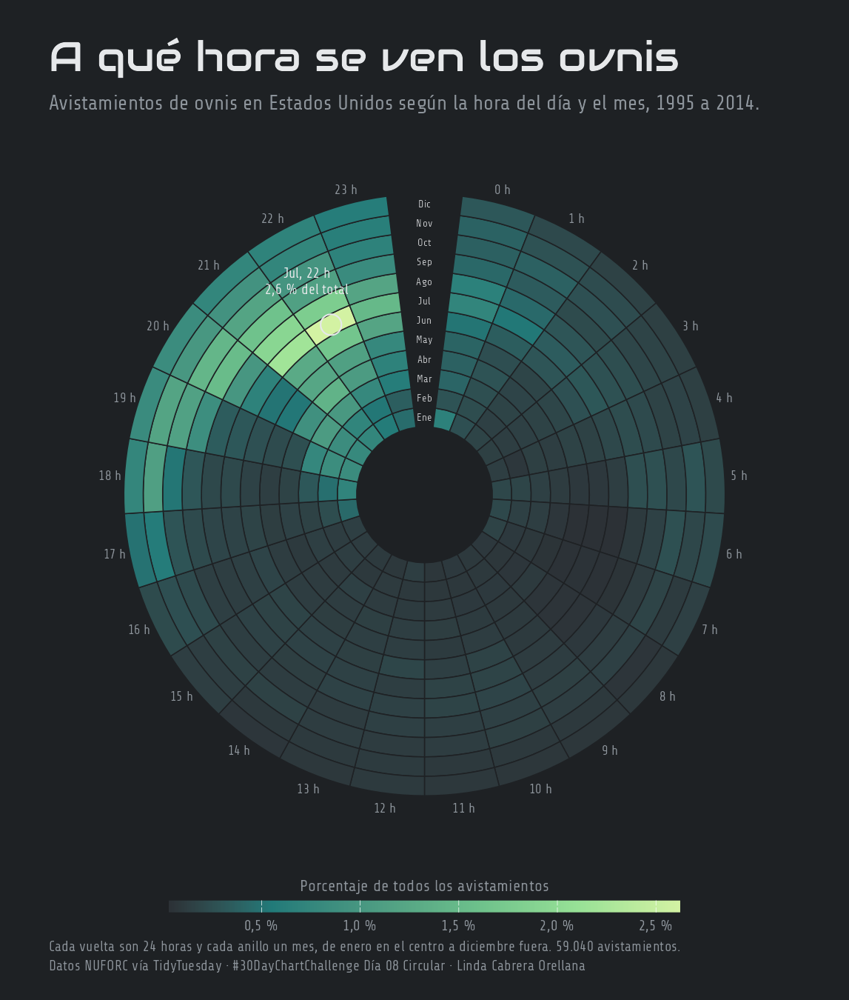

# Día 08 - Circular

 

## Pregunta

¿A qué hora y en qué época del año se ven más ovnis?

## Gráfico

Un mapa de calor radial funciona como un reloj, el ángulo es la hora del día y cada anillo un mes, de enero en el centro a diciembre por fuera. El color indica qué porcentaje de todos los avistamientos cae en esa hora y ese mes, así que las zonas claras son los momentos con más reportes.

Los ovnis se ven de noche, el 74 % de los avistamientos ocurre entre las 18 y las 2 de la madrugada, y la hora con más reportes son las 21. También se ven más en verano, cuando las noches son templadas y hay más gente fuera. La celda más clara es julio a las 22 horas, con el 2,6 % de todos los avistamientos, y el día del año con más reportes es el 4 de julio, con 1.039, seguido del 1 de enero con 461, las dos noches de fuegos artificiales en Estados Unidos.

## Datos

Los datos vienen del National UFO Reporting Center, que recoge los avistamientos que envía la gente, publicados en [TidyTuesday](https://github.com/rfordatascience/tidytuesday/tree/master/data/2019/2019-06-25) (semana del 25 de junio de 2019). Se cargan con `tidytuesdayR::tt_load("2019-06-25")`.

El dataset tiene 80.332 avistamientos de todo el mundo, de los que uso los 59.040 de Estados Unidos entre 1995 y 2014. La hora es la local del lugar del avistamiento, y el porcentaje de cada celda se calcula en el script sobre el total de avistamientos.

## Limitaciones

- Son reportes voluntarios, no avistamientos comprobados, así que el gráfico muestra cuándo la gente cree ver algo en el cielo y lo cuenta, no cuándo hay ovnis.

- Las fechas no siempre son exactas. El 15 de varios meses aparece más de lo esperable, lo que apunta a que parte de la gente redondea la fecha cuando no la recuerda bien, y lo mismo puede pasar con la hora.

- Los datos acaban en 2014 y vienen de una sola organización, así que no incluyen otros registros ni los reportes de los últimos años.

## Lo que aprendí

- Con un fondo oscuro, el color más bajo de la escala tiene que distinguirse del fondo.

- También aprendí que `coord_polar` reserva un margen alrededor del círculo, y que con `clip = "off"` y `oob = scales::oob_keep` las etiquetas de las horas se pueden dibujar fuera sin quitarle radio al reloj.

## Difusión

Pendiente
