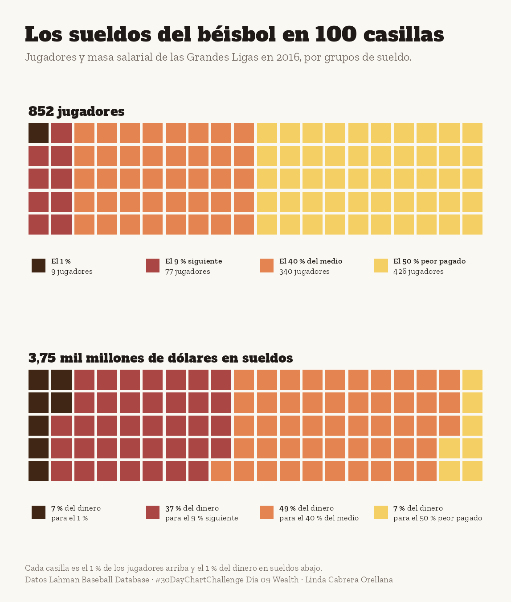

# Día 09 - Wealth

 

## Pregunta

¿Cómo se reparte el dinero entre los jugadores de las Grandes Ligas de béisbol?

## Gráfico

Un waffle de proporciones convierte un total en 100 casillas, así que cada casilla es un 1 % y las proporciones se cuentan casi sin leer números. Aquí hay dos waffles con los mismos cuatro grupos de jugadores ordenados por sueldo, arriba cada casilla es el 1 % de los jugadores y abajo el 1 % del dinero, y al rellenarse por columnas de izquierda a derecha los grupos quedan alineados como dos barras del 100 % hechas de casillas.

La comparación es muy desigual. El 1 % mejor pagado, 9 jugadores, se lleva el 7 % del dinero, y el 9 % siguiente, 77 jugadores, el 37 %, de modo que el 10 % mejor pagado acumula el 44 % de toda la masa salarial. En el otro extremo, el 50 % peor pagado, 426 jugadores, se reparte solo el 7 %, la misma parte que los 9 de arriba.

## Datos

Los datos vienen de la tabla `Salaries` del paquete [Lahman](https://cran.r-project.org/package=Lahman), que recoge la Lahman Baseball Database, y se cargan con `Lahman::Salaries`. Uso la temporada 2016, la última que incluye, con 852 jugadores y 3,75 mil millones de dólares en sueldos. Un jugador que cobró de dos equipos ese año aparece una sola vez con la suma de los dos sueldos.

## Limitaciones

- Cada casilla redondea al 1 %, así que un grupo pequeño puede ganar o perder una casilla por el redondeo.

- Los sueldos son los que recoge la base de datos para cada temporada y no incluyen primas, contratos publicitarios ni otros ingresos, así que la desigualdad real entre jugadores es probablemente mayor.

## Lo que aprendí

- Un waffle no tiene que ser de 10 por 10. Con 20 columnas por 5 filas los dos waffles caben uno encima del otro en el formato vertical.

## Difusión

Pendiente
