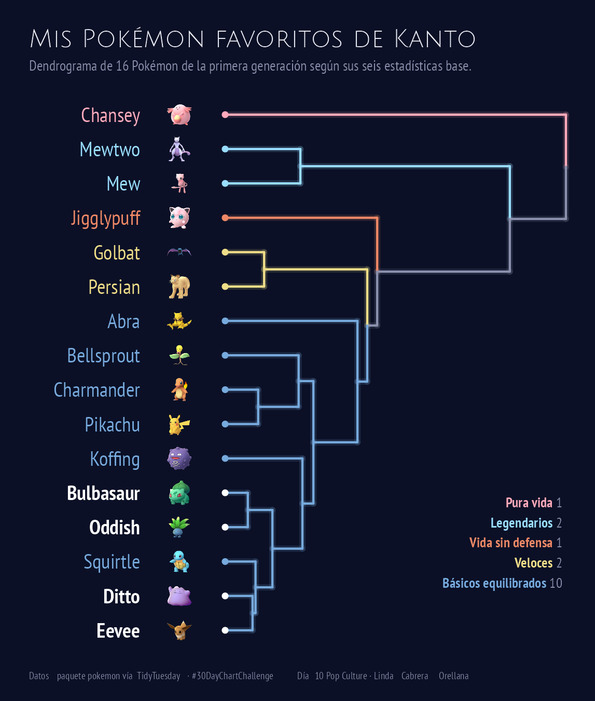

# Día 10 - Pop Culture

  

## Pregunta

¿Qué Pokémon de mis favoritos se parecen más por sus estadísticas?

## Gráfico

Un dendrograma muestra cómo se van uniendo los elementos según su parecido, empezando por las parejas más cercanas y subiendo hasta juntarlos a todos en una sola rama. Cuanto más a la izquierda se produce una unión, más parecidos son los Pokémon que junta, y cortando el árbol a una altura se obtienen los grupos, que aquí van coloreados.

Mis 16 favoritos forman cinco familias. Chansey va sola porque tiene 250 de vida y solo 5 de ataque y 5 de defensa, Mew y Mewtwo forman la familia de los legendarios con 600 y 680 puntos en total, Golbat y Persian se juntan por su velocidad, y Jigglypuff se queda aparte con mucha vida y casi nada de defensa. Los otros 10 son básicos equilibrados, y dentro de ellos están los gemelos estadísticos, Bulbasaur con Oddish y Eevee con Ditto, marcados en blanco.

## Datos

Las estadísticas base de la primera generación vienen del paquete pokemon a través de TidyTuesday del 1 de abril de 2025. Estandaricé las seis estadísticas con los 151 Pokémon, calculé la distancia euclídea solo entre mis favoritos y los agrupé con el método de Ward.

## Limitaciones

- Mezclo formas básicas con evoluciones y legendarios, así que el árbol separa sobre todo por nivel de poder y 10 de los 16 caen en el mismo grupo.
- El número de grupos y sus nombres son decisión mía a partir del perfil medio de cada uno.
- Solo uso las estadísticas base, sin tipos, movimientos ni habilidades.

## Lo que aprendí

- El paquete ggimage tiene `geom_pokemon()`, que coloca la imagen de cada Pokémon a partir de su nombre.
- Con pocas hojas, un dendrograma horizontal se lee mucho mejor que uno circular.
- Estandarizar con toda la generación y agrupar solo una parte mantiene la escala de referencia.

## Difusión

Pendiente
