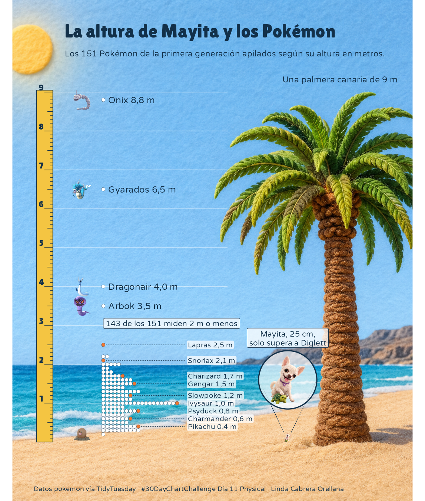

# Día 11 - Physical

  

## Pregunta

¿Cuántos Pokémon de Kanto son más pequeños que Mayita?

## Gráfico

Un dot plot de Wilkinson apila un punto por cada observación sobre su valor, así que cada pila es una altura y su largo dice cuántos Pokémon miden eso. Aquí todo está a escala física, un metro mide lo mismo en vertical que en horizontal, cada punto mide 10 cm como la precisión del dato, y la cinta métrica, la palmera y Mayita comparten esa misma escala.

Los 151 Pokémon de la primera generación miden entre 0,2 m y 8,8 m, con una mediana de 1 m, y 143 miden 2 m o menos. La pila más larga es la de 1 m, con 20 Pokémon, y solo cuatro superan los 2,5 m, Arbok con 3,5, Dragonair con 4, Gyarados con 6,5 y Onix con 8,8, casi la altura de la palmera. Mayita mide 25 cm y solo es más alta que Diglett.

## Datos

Las alturas vienen del paquete pokemon a través de TidyTuesday del 1 de abril de 2025 y son las alturas oficiales de los juegos, redondeadas a 0,1 m. El fondo es un diorama de playa con palmera canaria que escalé para que la palmera mida 9 m, y la imagen de Mayita está a su altura real de 25 cm.

## Limitaciones

- La palmera no tiene una altura real, la escalé a 9 m para que sirva de referencia.
- Con 151 puntos no se puede nombrar cada uno, así que solo señalo nueve Pokémon conocidos y los extremos.
- Las alturas de los juegos son oficiales pero ficticias, y algunos Pokémon cambian de tamaño entre generaciones.

## Lo que aprendí

- Con `annotation_raster()` en coordenadas de datos se puede escalar una imagen de fondo para que forme parte del gráfico.
- `coord_fixed()` y `ggforce::geom_circle()` permiten dibujar puntos con su tamaño físico exacto.
- `geom_pokemon()` de ggimage coloca las imágenes de los Pokémon por su nombre.

## Difusión

Pendiente
