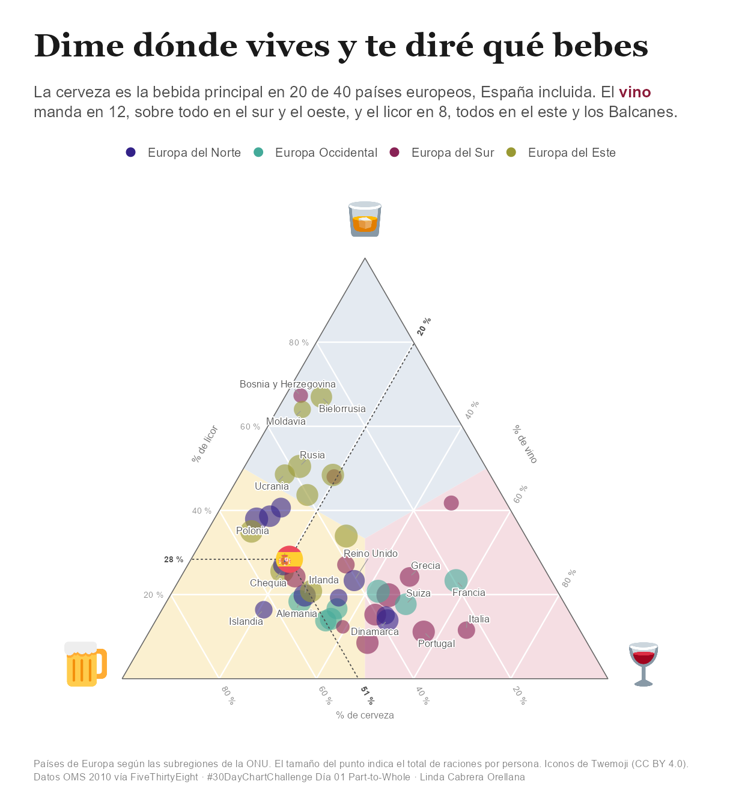
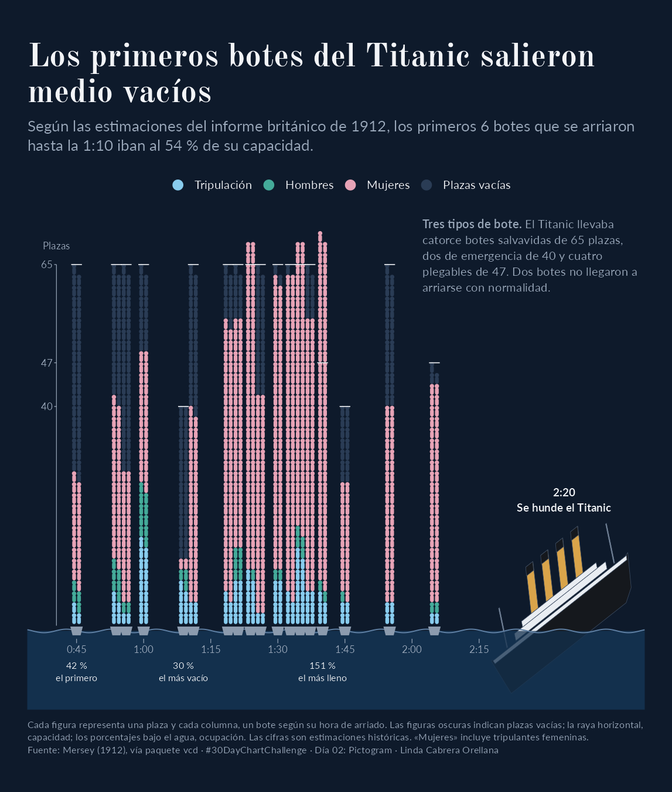

# 30DayChartChallenge

Mi participación en el [#30DayChartChallenge](https://github.com/30DayChartChallenge), un proyecto de visualización de datos desarrollado en **R con enfoque editorial**.

El objetivo es transformar conjuntos de datos en historias visuales, inspiradas en el periodismo de datos y los gráficos de medios de comunicación.

Cada visualización parte de una pregunta o un hallazgo y busca comunicar un mensaje claro mediante el diseño, la composición y anotaciones que guían la lectura.

<a href="2026/01-part-to-whole/"></a>
<a href="2026/02-pictogram/"></a>

## Estructura

``` text
30DayChartChallenge/
├── 2026/              Gráficos de la edición 2026
├── plantillas/dia/    Plantilla para nuevos gráficos
└── R/                 Funciones y utilidades compartidas
```

Cada día tiene su propia carpeta, por ejemplo, `2026/01-part-to-whole/`, que contiene:

- `README.md`: pregunta, fuentes, decisiones de diseño e interpretación del gráfico.
- `script-viz.R`: código R utilizado para generar la visualización.
- Imagen final de la visualización.

## Proceso creativo y uso de IA

Las visualizaciones combinan análisis de datos, diseño editorial y programación en R, utilizando inteligencia artificial como apoyo al desarrollo técnico.

**Mi proceso de trabajo incluye:**

1.  **Exploración de datos:** selección del conjunto de datos, identificación de patrones y definición de la pregunta.
2.  **Narrativa:** elección del mensaje principal y del enfoque editorial.
3.  **Diseño:** definición de la representación gráfica, composición, paleta de colores, tipografía y anotaciones.
4.  **Implementación:** desarrollo en R con asistencia de Claude para agilizar la programación y explorar soluciones técnicas.
5.  **Revisión:** validación de datos, ajustes del código y refinamiento visual de la composición final.

La conceptualización, las decisiones analíticas y la dirección creativa son propias. La IA interviene como asistente de programación dentro de un proceso iterativo que superviso y modifico directamente.

## Reproducir un gráfico

Los gráficos están desarrollados en R. Los paquetes necesarios se indican al principio de cada script.

Para reproducir una visualización, abre el proyecto en RStudio y ejecuta el archivo `script-viz.R` correspondiente al día, siguiendo las instrucciones específicas de su carpeta.

Para crear la estructura de un nuevo día, desde la raíz del proyecto:

``` r
source("R/nuevo_dia.R")
nuevo_dia(1, "Part-to-Whole")
```

## Datos y fuentes

Trabajo con conjuntos de datos públicos, entre ellos:

- [Rdatasets](https://vincentarelbundock.github.io/Rdatasets/)
- [TidyTuesday](https://github.com/rfordatascience/tidytuesday)
- [Wyscout Soccer Match Event Dataset](https://github.com/koenvo/wyscout-soccer-match-event-dataset)
- Conjuntos de datos propuestos por el propio #30DayChartChallenge.

Cada visualización incluye sus fuentes y, cuando corresponde, las decisiones metodológicas y limitaciones relevantes para interpretar los resultados.
